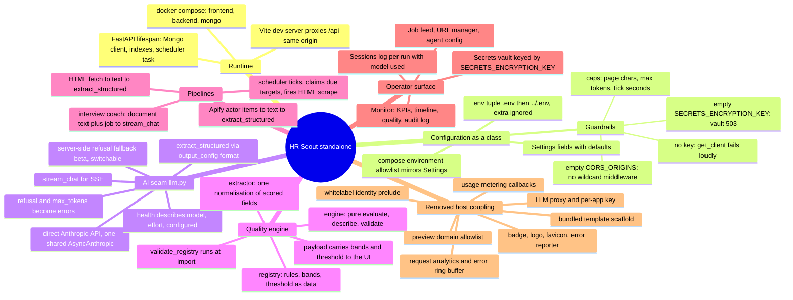
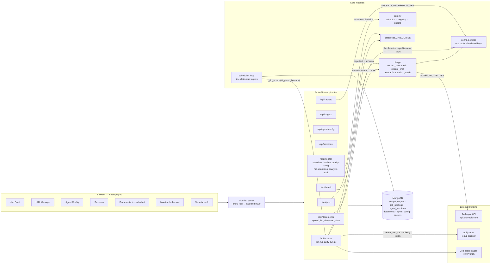
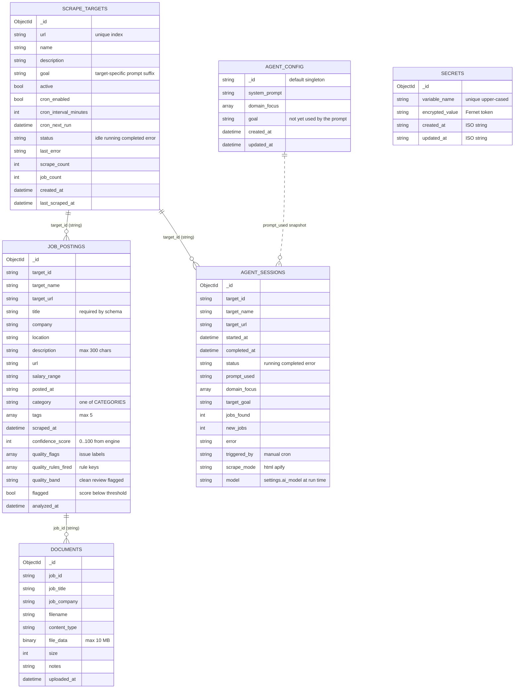

# HR Scout — system maps

Three views of the same system, kept next to the code so a change that moves
a boundary also moves a line here. Diagram 1 is the mental model (what the
pieces are and how they depend on each other), diagram 2 the logical flow
(who calls what, in which order), diagram 3 the data (collections, edges and
the quality matrix that sits orthogonal to them). A list of known drift —
things the maps show honestly but the code does not yet fix — closes the file.

Every fence renders with stock Mermaid (dagre layout) — GitHub's Markdown
preview shows them as-is. To re-check after an edit without pushing, run the
`render_check.mjs` script bundled with the `standalone-refactor` skill against
this file (`node render_check.mjs docs/SYSTEM_MAPS.md`); it needs
`playwright-core` and `mermaid` installed in the directory you run it from.

---

## Diagram 1 — unified mental model

What the standalone app is made of, and what was cut away from the generated
version. Read clockwise from the top: runtime → configuration → the one AI
seam → the quality engine → the two pipelines that feed it → the operator
surface, then the branch of host pieces that no longer exist.

---

## Diagram 2 — logical map

Routes, the two Claude call sites, the background loop and the external
systems. Everything the browser does goes through the Vite proxy to `/api`;
every model call goes through `app/llm.py`; every persisted record lands in
the app's own MongoDB.

---

## Diagram 3 — schema map

Collections and the string-ID edges between them. The quality fields on
`job_postings` are written by `/api/monitor/analyze` from the registry; the
matrix after the diagram is the orthogonal view — which rule reads which
field — and is generated from the same registry the API serves.

### Quality matrix — rules × scored fields

Generated from `app/quality/registry.py` (the same data `/api/monitor/quality-config`
returns). A `●` means the rule reads that field; the penalty is subtracted
from 100 when the rule fires; a final score below **70** is flagged.
Bands: clean 90–100 · review 70–89 · flagged 0–69.

| rule | penalty | title | description | company | salary_range | predicate |
|---|---:|:-:|:-:|:-:|:-:|---|
| `title_too_short` | 40 | ● | | | | len < 3 |
| `title_too_long` | 15 | ● | | | | len > 200 |
| `url_in_title` | 20 | ● | | | | regex `https?://` |
| `title_repeated_words` | 10 | ● | | | | > 4 words and unique ratio < 0.65 |
| `html_artifacts` | 20 | ● | ● | ● | | regex tag or entity, first field named |
| `template_tokens` | 30 | ● | ● | | | regex `{{ }}` `[[ ]]` `<% %>` |
| `control_chars` | 25 | ● | ● | | | regex control bytes |
| `company_missing` | 10 | | | ● | | empty |
| `description_too_brief` | 10 | | ● | | | non-empty and len < 15 |
| `salary_no_digits` | 5 | | | | ● | non-empty and no digit |

---

## Known drift

Behaviour the maps describe as it is, not as it should be. None of these were
introduced by the standalone translation; they are the generated app's open
items, listed so the next pass starts from facts.

- **No authentication anywhere.** Every route is open to whoever reaches
  port 8000: scrape triggers spend Anthropic and Apify budget, deletes are
  unconfirmed, and `GET /api/secrets/{name}/value` returns plaintext. Put the
  API behind a reverse proxy with auth before exposing it beyond localhost.
- **Targets can stick in `running`.** A crash or `--reload` mid-scrape leaves
  the target and its session `running`; the scheduler skips it and manual
  triggers return 409. No route resets `status`.
- **Scheduler claims are not atomic.** `scheduler_loop` finds due targets,
  then updates each; with more than one backend process the same target can
  be scraped twice. Tasks are fire-and-forget (`asyncio.create_task` without a
  reference).
- **Naive UTC datetimes.** `datetime.utcnow()` values are serialised without an
  offset, so browsers read them as local time and relative times drift by the
  viewer's UTC offset. (`utcnow` is also deprecated on Python 3.12.)
- **Deletes do not cascade.** Deleting a target removes its postings only;
  documents (with file bytes) and sessions stay behind.
- **SSE parser in `DocumentsPage` splits on `\n` per chunk** without buffering a
  frame split across reads, so a token can be dropped under slow networks.
- **`cron_interval_minutes` is not validated**; 0 or a negative value fires on
  every tick.
- **Raw filename in `Content-Disposition`** on document download; a non-latin-1
  name produces a 500.
- **Apify token travels as a URL query parameter** (the actor API's shape); it
  will appear in any proxy log.
- **MongoDB runs without auth** and relies on compose not publishing its port.
- **`agent_config.goal` never reaches the prompt**; only `domain_focus` and the
  per-target `goal` do.
- **Dev-mode containers only.** `uvicorn --reload` and `npm run dev`; there is
  no production image or static build served by the backend.
- **Unused surface:** the text index on `job_postings`, `DELETE /api/jobs/{id}`,
  the sessions filter parameters, and `POST /api/admin/revoke-keys` (clears
  collections nothing writes to).
- **`LICENSE` is still the generator's placeholder.** Choosing a license is the
  owner's decision; the file was left untouched.
